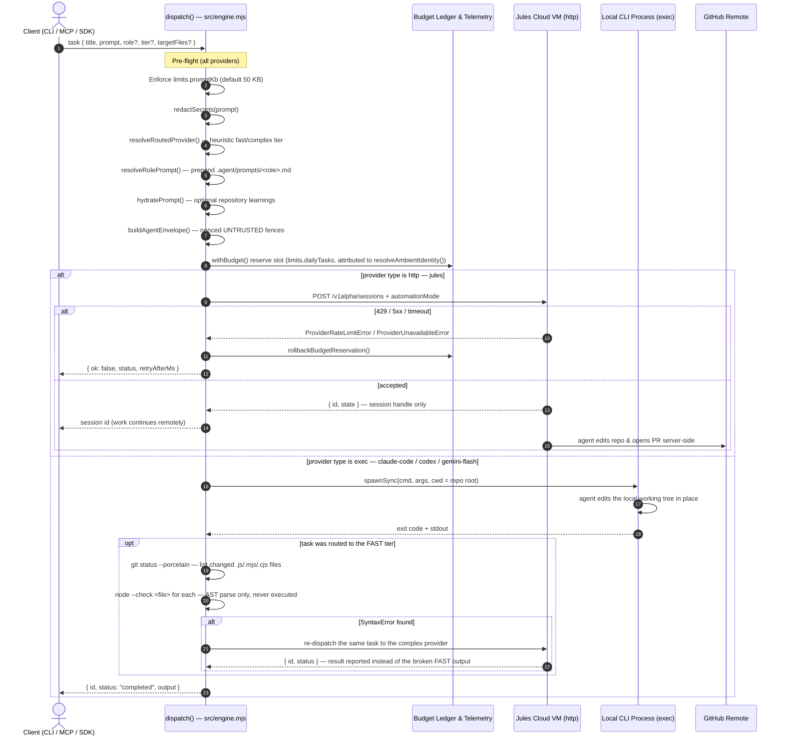
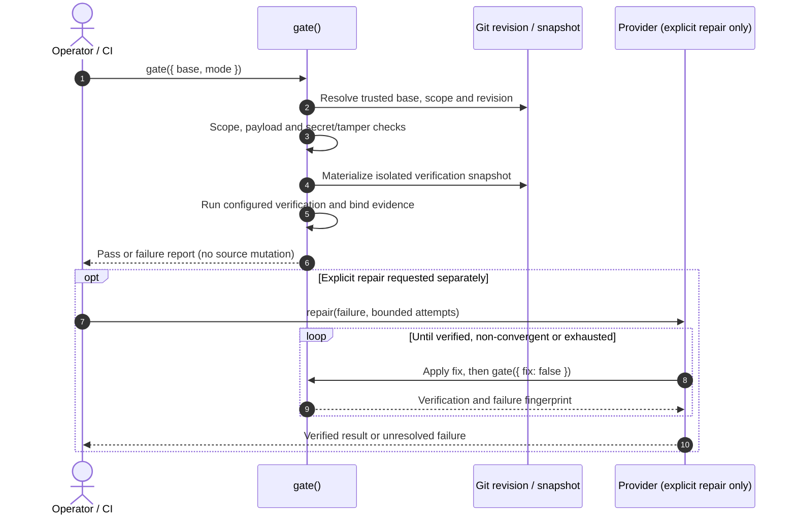
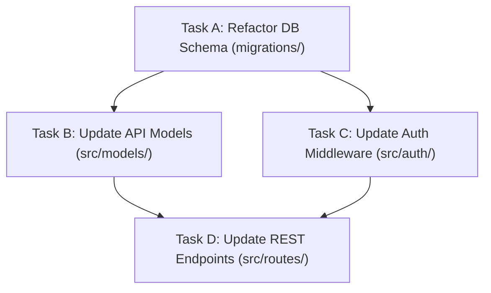

# Architecture & Pipeline Flow

`jules-orchestrator-kit` is **two decoupled pipelines**, not one linear flow:

1. **Dispatch** (`agentctl dispatch`, `task create` → `queue`) — routes, hydrates and envelopes a task, then hands it to a provider.
2. **Verification** (`agentctl gate`) — audits a working tree or branch without mutating source code. Repair is an explicit separate operation.

They communicate through the repository and the telemetry ledger, not through a shared call stack. `dispatch()` never invokes the gate; `repair()` owns the bounded repair loop and calls `gate()` to verify each attempt.

> [!IMPORTANT]
> **Where code changes land depends entirely on the provider type.** This is the single most important thing to understand before reading the diagrams below — the two modes execute in different machines.

---

## Provider Execution Models

`createProvider()` (`src/provider.mjs`) returns one of two fundamentally different adapters:

| | `type: "http"` — remote agent | `type: "exec"` — local agent |
| :--- | :--- | :--- |
| **Built-in presets** | `jules` | `claude-code`, `codex`, `gemini-flash` |
| **Transport** | `fetch()` → `POST https://jules.googleapis.com/v1alpha/sessions` | `spawnSync(command, args, { cwd: config._root, shell: false })` |
| **Where the agent runs** | Google's Cloud VM, against the **connected GitHub repo** | This machine, in the **local checkout** |
| **What touches your files** | Hosted execution leaves the local checkout unchanged. Fetching a branch or applying a session patch imports changes separately. | The spawned CLI writes directly to the working tree. |
| **Return value** | Session handle with `kind: "remote-session"` — work continues asynchronously | `{ id, kind: "local-result", status: "completed", output }` — local execution is done |
| **Who opens the PR** | **Jules does**, server-side, when `automationMode: "AUTO_CREATE_PR"` is set in the request body (`src/provider.mjs`) | Nobody — no PR is created |
| **Credentials** | `JULES_API_KEY` via `X-Goog-Api-Key` header | Provider CLI's own auth (e.g. `GEMINI_API_KEY`) |

`automationMode` is written into the HTTP body only, so it has no meaning for exec providers.

---

## Provider Lifecycle Contract

Under `.agent/config.yml` semantics, every provider adapter reports its execution model across six distinct operational phases:

```text
1. Configuration & Resolution
   ↓
2. Readiness & Token Pre-Flight
   ↓
3. Envelope & Quota Reservation
   ↓
4. Execution (Local Sync exec  vs. Remote Async http)
   ↓
5. Continuation / Plan Approval (HTTP resume & approvePlan)
   ↓
6. Session Inspection (list / inspect / activities / sources)
```

### 1. Configuration & Resolution
- **Primary Provider**: Selected by `provider` in `.agent/config.yml` (default `"jules"`).
- **Cost & Complexity Router**: When `router.enabled: true`, `resolveRoutedProvider()` evaluates prompt heuristic complexity against `router.threshold`. Trivial/mechanical tasks route to `router.fast` (`gemini-flash`), while complex or safety-critical tasks route to `router.complex` (`jules`).
- **Failover Cascade**: `createFailoverProvider([primary, fallback])` cascades sequentially when a provider throws `ProviderRateLimitError` (HTTP 429) or `ProviderUnavailableError` (HTTP 5xx / timeout).

### 2. Readiness & Token Pre-Flight
- **Exec Providers (`claude-code`, `codex`, `gemini-flash`)**: Readiness checks verify the CLI binary exists on system `PATH`.
- **HTTP Providers (`jules`)**: `TokenPool.fromEnv()` rotates keys across `JULES_API_KEY`, `JULES_API_KEYS`, and `config.julesApiKeys`.
  - **429 Cooldown**: Rate-limited tokens enter quarantine for `retryAfterMs` (default 60s) before re-entering round-robin rotation.
  - **Utilization Balancing**: Token Pool selects available non-cooldown tokens with the lowest 24-hour utilization ratio.

### 3. Envelope & Quota Reservation
- **Dispatch budget**: `withBudget()` reserves a slot against `limits.dailyTasks` per rolling 24-hour window. The allowance depends on the configured tier or explicit limit.
- **Payload Limits**: Prompts are checked against `limits.promptKb` (50 KB default) and secrets are redacted before dispatch.

### 4. Execution Pipeline
- **Exec Lifecycle (Local Synchronous)**:
  - Spawns the local binary via `spawnSync()`.
  - Mutates files directly in the working tree.
  - **Syntax Verification Escalation**: Fast-tier exec dispatches are wrapped by `createSyntaxVerifiedProvider()`. Changed `.js`/`.mjs`/`.cjs` files are parsed via V8's native `node --check`. If syntax errors are detected, the task silently re-dispatches to the complex provider without trusting broken output.
- **HTTP Lifecycle (Remote Asynchronous)**:
  - Dispatches `POST` request to `https://jules.googleapis.com/v1alpha/sessions`.
  - Returns immediate session handle `{ id, status: "active" }`. Work continues asynchronously on remote VM.
  - Server-side PR creation is enabled when `autoPr: true` sets `automationMode: "AUTO_CREATE_PR"`.

### 5. Warm Resumption & Plan Approval
- **Warm Resumption (`provider.resume()`)**: Sends feedback/instructions to an existing session via `POST /v1alpha/sessions/{id}:sendMessage`. If the remote session is expired or closed (HTTP 400/404), `resume()` fails soft and re-dispatches as a cold session.
- **Plan Approval (`provider.approvePlan()`)**: When `requirePlanApproval: true` is set, the session pauses for human approval and resumes via `POST /v1alpha/sessions/{id}:approvePlan`.

### 6. Session Inspection
- HTTP providers support programmatic session and source inspection via `getSession()`, `listSessions()`, `listActivities()`, and `listSources()`.
- Destructive remote account housekeeping (`archive`, `delete`, bulk `prune`) is intentionally excluded from the provider adapter and MCP surface.

---

## Pipeline A — Task Dispatch

`dispatch()` in `src/engine.mjs` prepares the task and optionally records a pre-dispatch Git checkpoint. It does not create a working branch, commit, push, or run the verification gate.



When the router is enabled, a `fast`-tier task is dispatched through `createFailoverProvider([verifiedFast, complex])`, so a rate-limited fast provider transparently cascades to the primary one. The `fast` leg of that cascade is itself wrapped by `createSyntaxVerifiedProvider()` (`src/provider.mjs`), which is a second, independent escalation path: even a `200`/exit-`0` result from the fast tier gets its locally-changed `.js`/`.mjs`/`.cjs` files parsed with `node --check` before being trusted, and a verified syntax failure re-dispatches through the primary provider transparently. This only inspects files an **exec**-type provider mutated in the local working tree; a fast tier pointed at a remote HTTP provider has nothing local to check and the gate is a no-op.

---

## Pipeline B — Non-mutating verification and explicit repair

`gate()` verifies the selected working tree or revision. It always forces `fix: false`:
verification failure is reported, not repaired behind the operator's back.
`repair()` is a separate explicit, bounded operation; it uses `gate()` after
each attempt and stops on repeated failure fingerprints.



### On warm session resumption

`provider.resume()` targets `POST /v1alpha/sessions/{id}:sendMessage`, with a
fail-soft cold-dispatch fallback on HTTP 400/404. `agentctl resume` is the
human-in-the-loop path. The bounded repair path currently cold-dispatches
each retry via `provider.dispatch()`; it does not claim warm-session reuse.

### Evidence-grounded preflight

`dispatch --check-premise` never treats a passing generic `--verify-cmd` or
envelope verification command as proof that a new feature already exists.
To allow `ALREADY_SATISFIED`, explicitly supply `--goal-check <command>` that
returns zero only when the requested outcome is present. The check must be
non-placeholder, distinct from generic verification, and pass on an unchanged
clean Git revision. Otherwise dispatch proceeds. Its decision and bounded
evidence (revision, command hash, exit code and duration) are recorded as
`dispatch_decision` telemetry. A dry run does not execute the goal check.

Example:

```sh
agentctl dispatch --prompt "Add feature X" --verify-cmd "npm test" \
  --check-premise --goal-check "node scripts/check-feature-x.mjs"
```
---

## Queue dependency ordering

`executeQueueDag()` in `src/dag-engine.mjs`.

Resolves inter-task dependencies for tasks authored with `--depends-on <id,...>`.



1. **Task Selection by Shape**: A queue-directory entry is executed only if it *is* a task: a `.md` file passing `isTaskFile`, a `.task` file, or a `.json` object carrying a non-empty `prompt` that is not a `tasks`/`envelopes` container. Manifests and the queue's own `README.md` are skipped and left in place.
2. **Kahn's Topological Sort**: Parses task frontmatter envelopes in `.agent/jules-queue/` and calculates dependency execution order.
3. **Cycle Detection**: Automatically rejects cyclic dependencies (`DagCycleError`) before starting execution.
4. **DAG Concurrency Slots**: Executes unblocked leaf tasks in parallel while ensuring downstream tasks wait for dependency completion.

---

## Verification Gate Phases

The gate resolves policy from a trusted base commit, preferring its remote-tracking ref. Phases short-circuit on failure. Refresh refs and inspect the selected base; see [the threat model](../SECURITY.md).

| Phase | Component | Enforcement | Exit code |
| :--- | :--- | :--- | :--- |
| **1. Scope** | `checkScope()` (`src/scope-guard.mjs`, re-exported by `src/security.mjs`) | Modified + untracked files vs `scope.deny` → `scope.allow` → `scope.protect`. Deny is evaluated first and unconditionally, against a path canonicalised by `canonicalizePath()` and matched **case-insensitively**; paths escaping the repo root are rejected outright. Allow stays case-sensitive so a mismatch fails closed. | `3` |
| **2. Payload** | `diffBytes()` (`src/git.mjs`) | Inclusive `<=` against `limits.diffKb * 1024` (default 75 KB), measured in UTF-8 bytes. | `5` |
| **3. Diff Scan** | `scanDiff()` (`src/security.mjs`) | Diff detectors folded into one phase — see below. `scanDiff()` is the orchestrator; the detectors it calls live in `src/secret-scanner.mjs`, `src/test-tamper-guard.mjs` and `src/bidi-guard.mjs`, all re-exported from `src/security.mjs`. | `6` |
| **4. Verify** | Staged runner + `preload-net-guard.mjs` | Runs the configured stages as sub-processes with a `NODE_OPTIONS` network guard, honouring `verify.policy.networkAccess`. | `4` (or `8` on flaky quarantine) |
| **5. Evidence** | `generateEvidenceManifest()` (`src/evidence.mjs`) | SHA-256 manifest of changed files plus pre/post test-file hashes; a mismatch reports changes during verification; hashes do not establish intent or authenticate the writer. | `3` |

### Task scope and commit provenance

Exit `0` is a verdict on the **repository** policy. A task envelope can narrow
that policy (`scope.allow` / `scope.deny` in its front matter), and the gate
applies the narrower scope only when you pass it: `agentctl gate --task <envelope>`
(SDK: `gate({ task })`). The check uses `checkScope()` on the same candidate file
list and revision as phase 1, so a candidate must satisfy both. A violation is a
`task_scope` phase failure with exit `3`; no exit code was added.

- The envelope is operator input, and its `envelope.source` says how far it can
  be trusted. A path the candidate changes is refused
  (`TASK_ENVELOPE_IN_CANDIDATE`). `base`: tracked on the trusted base and read
  from that commit. `file`: outside the repository. `worktree`: an untracked
  file inside it, such as an ignored queue envelope. That last kind is accepted
  only for a committed candidate (`--committed`); in `working-tree` and `staged`
  mode the working tree is the candidate, so such a file is refused
  (`TASK_ENVELOPE_UNTRUSTED_SOURCE`). Limit: a `worktree` envelope is the file
  on disk, and a local agent that edited it before you reviewed a commit leaves
  nothing in the diff. Compare `envelope.sha256` with your own copy, or keep the
  envelope outside the repository.
- A scope that is present but not a list of non-blank strings (a string, a
  number, a mixed list) fails closed (`TASK_ENVELOPE_INVALID`) instead of reading
  as no restriction. A missing or unparseable envelope fails closed as well.
- Every report carries `taskScope`. Without `--task` it is
  `{ "checked": false, "reason": "NO_TASK_ENVELOPE" }`, also recorded in the
  evidence manifest, so a passing gate cannot be mistaken for a task-level pass.
  An envelope that names no paths reports `unconstrained: true`.
- Every report carries `commitProvenance`: author, committer and signature status
  (`%G?`) of each commit in `base..head`. The evidence manifest keeps names but
  not e-mail addresses; the live report keeps both. It is observation only. It never changes
  the exit code; whether an unsigned commit is acceptable is the reviewer's call.
  Signature status depends on the local `gpg.ssh.allowedSignersFile` or keyring.

For a provider candidate, the gate reports these separately from the provider's
own status: the session being `COMPLETED` (see `session get`), the repository
gate result, `taskScope`, and `commitProvenance`. None of them is an approval;
that stays a human decision.

### Phase 3 is a diff scanner, not only a secret scanner

`scanDiff()` reduces the diff to added lines (`+`, excluding `+++` headers) and emits findings from the detectors below. Blocking findings map to exit `6`:

| Finding type | Detector |
| :--- | :--- |
| `HIGH_CONFIDENCE_SECRET` / `LOW_CONFIDENCE_SECRET` | Regex pattern lists (AWS, GitHub, OpenAI, Stripe, private keys, bearer tokens). Run against as-written and normalized variants, including invisible-character removal and source-level string concatenation collapse |
| `HIGH_CONFIDENCE_SECRET` (encoded) | `hasEncodedSecret()` (`src/secret-scanner.mjs`) — base64 blobs on added lines are decoded and matched, so a key in a Kubernetes `Secret` manifest or a base64'd `.env` is not invisible to a line-oriented scanner. The description names the encoding; the type is deliberately the same, so every gate that already blocks on a cleartext key blocks on this one |
| `HIGH_ENTROPY_TOKEN` | `hasHighEntropyToken()` — a heuristic for unstructured tokens on added lines, with exclusions for lockfiles, digests and recognized noise |
| `EDGE_RUNTIME_VIOLATION` | `checkEdgeRuntimeImports()` — unsupported `node:*` built-ins in Cloudflare / Vercel / Netlify Edge contexts |
| `CROSS_PACKAGE_BOUNDARY_VIOLATION` | `checkCrossPackageImports()` — illegal cross-package imports in a monorepo |
| Assertion and test-discovery findings | `checkTestTampering()` — recognized weakening, skipped assertions and tests removed from discovery |
| Unicode findings | `checkUnicodeSecurity()` — suspicious direction controls, invisible characters and mixed scripts in non-Markdown additions |

Decoded bytes are matched against high-confidence credential patterns. Entropy
alone would flag ordinary encoded data. Decoding is bounded, so this check is
not an exhaustive search of every possible encoding. Investigate findings in
context and use dedicated secret-scanning tooling when broader coverage is needed.

### Shannon entropy thresholds

Entropy is a heuristic used in the diff scanner and prompt checks, with separate thresholds:

| Threshold | Location | Purpose |
| :--- | :--- | :--- |
| `> 4.5` | `hasHighEntropyToken()` (`src/secret-scanner.mjs`) | Flags candidate tokens of at least 24 characters on added diff lines, subject to exclusions |
| `> 3.6` | `redactSecrets()` (`src/secret-scanner.mjs`) | Decides which **environment variable values** get masked in log and diff output |
| `> 4.3` | `planTaskCreate()` (`src/wizard-task.mjs`) | Flags a high-entropy **token** inside a task prompt pre-dispatch |
| `> 4.5` | `planTaskCreate()` (`src/wizard-task.mjs`) | Flags a short prompt that is high-entropy **in aggregate** |

---

## Exit Code Registry

| Code | Meaning |
| :--- | :--- |
| `0` | Success — verification passed. |
| `1` | Pre-dispatch / argument failure; prompt exceeds `limits.promptKb`. |
| `2` | Provider API failure — HTTP 429, 5xx, or timeout. |
| `3` | Scope violation, **or** test-file tampering detected by the evidence manifest. |
| `4` | Verification failed — bounded repair exhausted, not run, or aborted early by the circuit breaker. |
| `5` | Diff payload exceeds `limits.diffKb`. |
| `6` | Phase 3 finding — secret, edge-runtime import, or cross-package boundary violation. |
| `7` | Daily task quota (`limits.dailyTasks`) exhausted. |
| `8` | Flaky test quarantined (Wilson-score oscillation >= 0.40); bounded repair suppressed deliberately. |

---

## Execution boundaries

Verification commands execute with the runner account's OS permissions. The snapshot, filtered environment and Node network preload are not an OS sandbox. Use disposable runners for untrusted code. Evidence hashes establish consistency, not signed attestation.

Optional notifications, quality probes and other compatibility operations are documented in the [command reference](COMMAND_REFERENCE.md). They are separate from the core dispatch and verification flow.

The core operations have the following boundaries:

- **It does not provision git worktrees.** `src/git.mjs` exports `worktreeRemove()` and `worktreePrune()` — cleanup utilities used by `agentctl clean` to reap worktrees created by external swarm tooling. Nothing in the codebase runs `git worktree add`.
- **It does not commit, push, or open pull requests.** For `type: "http"`, Jules does this server-side via `automationMode`. For `type: "exec"`, the changes are simply left in the working tree for you to review.
- **`run()` does not verify.** It dispatches each queued task, moves the envelope to `.agent/jules-queue/completed/`, and appends to the ledger. Verification is a separate `agentctl gate` invocation.
- **`queue --dry-run` writes nothing.** It previews the dispatch of every queued task and then leaves the filesystem exactly as it found it — no move to `completed/`, no directory creation, no ledger entry — so the same queue can be previewed repeatedly.
- **The repair loop belongs to explicit `agentctl repair`, not `dispatch` or `gate`.** Neither `agentctl dispatch` nor `agentctl gate` mutates source code to self-heal.
